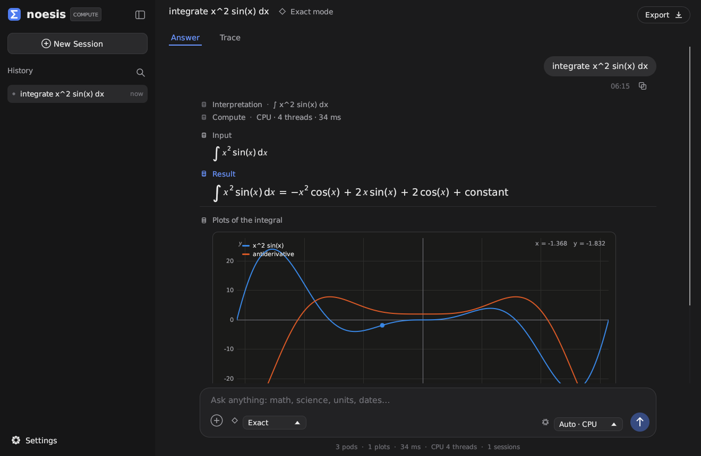
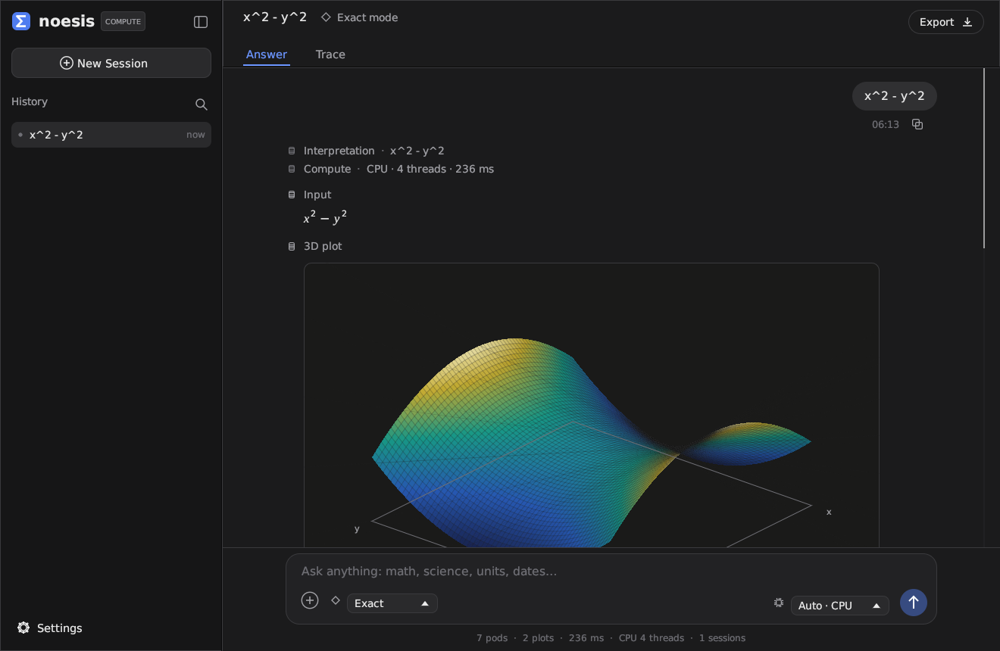
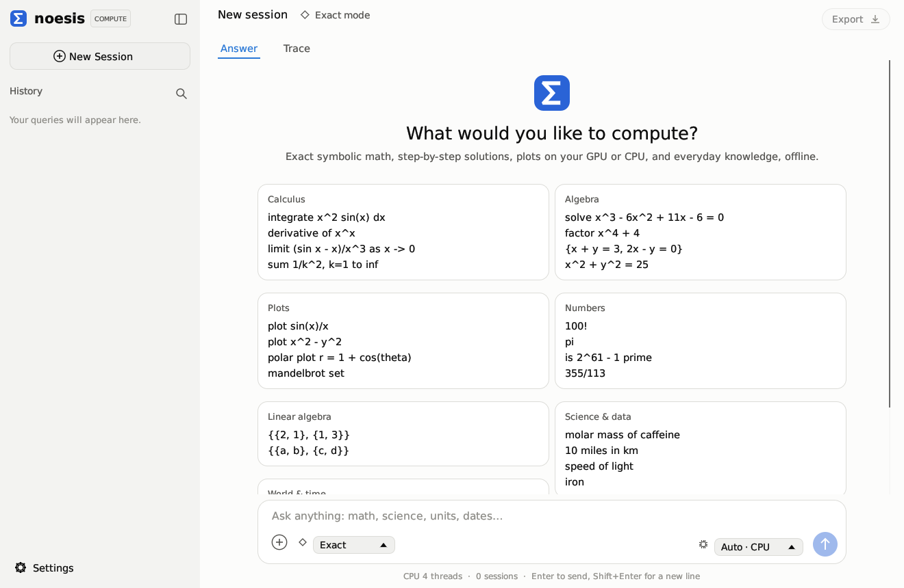
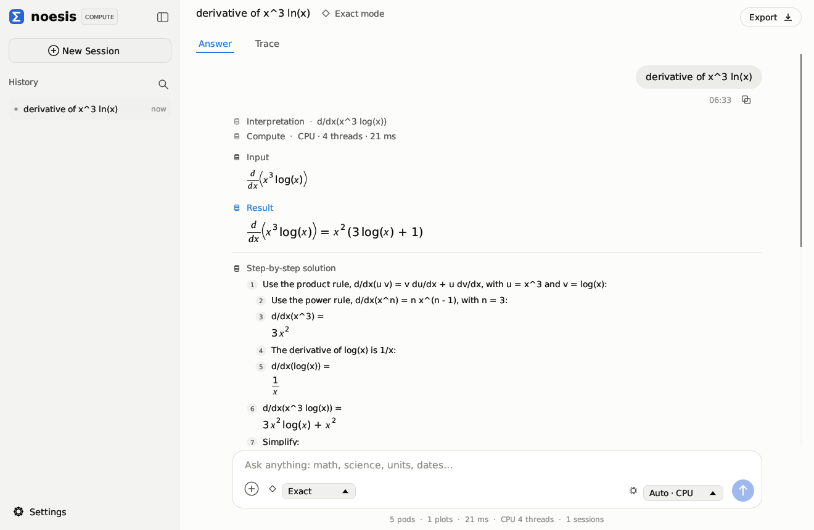
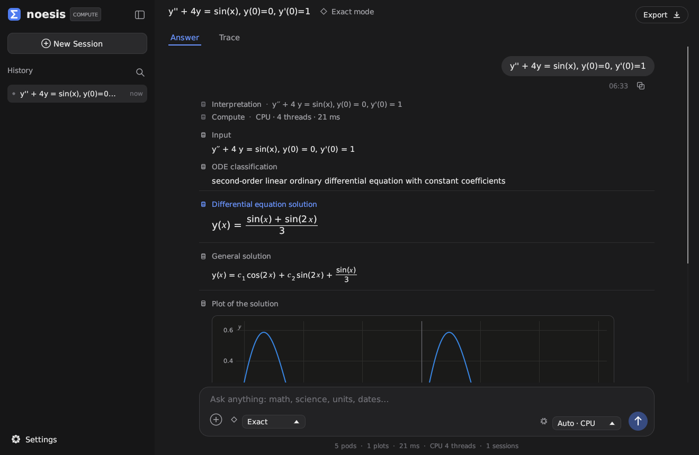

# Noesis

**An open-source computational knowledge engine, written in Rust, that runs offline on your CPU and GPU.**

Type a calculation, an equation, a function, a question in plain English or a unit conversion, and Noesis answers the way WolframAlpha does: with a stack of result *pods*. These include the interpreted input, an exact result, decimal approximations, alternate forms, roots, plots, derivatives, integrals, series and step-by-step working. It is a desktop app for Linux and Windows, and a command-line tool.



| 3-D surface, rotatable | Welcome screen (light theme) |
| --- | --- |
|  |  |
| **Step-by-step derivative** | **Initial value problem** |
|  |  |

## What it can do

| Area | Examples |
| --- | --- |
| Arithmetic and numbers | `2^100`, `100!`, `355/113`, `pi` to 50 digits, `(1+2i)^3`, number names, prime factorization, divisors, bases, Roman numerals, continued fractions |
| Algebra | `factor x^4 + 4`, `expand (x+1)^5`, `partial fractions 1/(x^2-1)`, `simplify sqrt(3 + 2 sqrt(2))`, alternate forms |
| Equations | `solve x^3 - 6x^2 + 11x - 6 = 0`, `sin(x) = 1/2` (general solution with n ∈ ℤ), `e^(2x) - 3e^x + 2 = 0`, radical and absolute-value equations, Cardano formulas, numeric roots |
| Systems and inequalities | `{x^2 + y^2 = 25, x + y = 7}`, `{2x + 3y - z = 1, …}`, `(x-1)/(x+2) >= 0` → `x < -2 or x ≥ 1` with a number line |
| Calculus | `derivative of x^x` (with steps), `integrate x^2 sin(x) dx` (with steps), `integrate e^(-x^2) from -inf to inf`, `limit (sin x - x)/x^3 as x -> 0`, `lim (x,y)->(0,0) x y/(x^2+y^2)` (path analysis and polar proofs), `taylor series of e^x`, `sum 1/k^2, k=1 to inf`, `product k, k=1 to n` |
| Differential equations | `y'' + y = 0`, `y' = x y`, `dy/dx = x/y`, `y'' - 3y' + 2y = e^x`, `y'' + 4y = sin(x), y(0)=0, y'(0)=1`: classification, general solution, solution of the initial value problem, solution families; Runge–Kutta numeric solutions when there is no closed form |
| Partial differential equations | `u_t = u_xx, u(0,t) = 0, u(1,t) = 0, u(x,0) = x(1 - x)` (Fourier series with a coefficient formula), `u_tt = 4 u_xx, u(x,0) = e^(-x^2), u_t(x,0) = 0` (d'Alembert), `u_t + 2 u_x = 0, u(x,0) = sin(x)` (characteristics), Laplace on a rectangle, classification |
| Course topics | `directional derivative of x^2 + y^2 at (1,1) in direction (1,0)`, `tangent plane to z = x^2 + y^2 at (1,1)`, `lagrange multipliers maximize xy subject to x + y = 10`, `interval of convergence of sum x^n/n`, `mean value theorem for x^2 on [0, 2]`, Riemann sums, trapezoid and Simpson's rules, Newton's and bisection methods, Euler's method, volumes and surface areas of revolution, centroids, polar areas, `chi square test 10 20 30 vs 20 20 20`, `t test 5.1 4.9 5.3 5.0 mean 5`, hypergeometric and geometric distributions, sample sizes |
| Advanced topics | `solve x^2 = 2 mod 7`, `inverse of 3 mod 11`, `pell equation x^2 - 2y^2 = 1`, `partitions of 10`, `bessel j0(2.5)`, `elliptic integral K(0.5)`, `singular values of {{3,0},{4,5}}`, `qr decomposition of …`, `matrix exponential of {{0,1},{-1,0}}`, `jordan form of …`, `solve x' = 2x + y, y' = x + 2y`, `recurrence a(n) = a(n-1) + a(n-2), a(0)=0, a(1)=1`, `z transform of 2^n`, `residue of 1/(z^2+1) at z = i`, `contour integral of 1/z around unit circle`, exact infinite products (`product k^2/(k^2 - 1/4) from k=1 to infinity` = π/2) and alternating series |
| Calculus in words | `is 1/x continuous at x = 0`, `discontinuities of tan(x)`, `is x^3 concave up at x = 2`, `concavity of x^3 - 3x on (0, 2)`, `jacobian of (r cos t, r sin t) wrt (r, t)`, `integrate x^2 y dx dy x=0..1 y=0..2`, `volume of revolution of x^2 from 0 to 1 about the y-axis`, `arc length of (cos t, sin t) from 0 to pi`, `limsup (-1)^n`, `saddle points of x^2 - y^2` |
| Coordinate geometry | `complementary angle of 30deg`, `reference angle for 300 degrees`, `what quadrant is (1,2) in`, `plane through (0,1,0), (5,6,7), (6,7,8)`, `rotate {1, 1} pi/3 radians`, `reflect {2, 1} over y = -2x`, `line, slope=1/5, y-intercept=3`, `reflect x^2+y^2=1 about y=x+1`, `reflect across x+y+z=1`, `rotate (3 pi)/4 radians around the z-axis`, `yaw=30 degrees, roll=22 degrees`, `Euler angles: 30 degrees, 40 degrees, 33 degrees`, `vertical shear 45 degrees`, `parabola with focus (3,4) and vertex (-4,5)`, `z-intercepts of x/2 - y/3 + z/12 = 2` |
| Geometric objects | `dodecahedron`, `truncated icosahedron with edge 2`, `Archimedean solids`, `tesseract`, `600-cell`, `cross polytope`, `glome of radius 2`, `spherical cap r=5 h=2`, `Steinmetz 2-solid`, `Reuleaux triangle`, `cylinder, radius=3, height=4`, `5, 12, 13 triangle`, `cardioid`, `arc length of an astroid`, `deltoid vs ranunculoid`, `tangent vector Viviani's curve`, `trefoil knot`, `Stevedore knot, figure eight knot`, `pi_5(S^2)`, `[3,8)`, `polyominoes`, `hexiamonds` |
| Algebra and discrete tools | `quaternion 1+2i-j-3k`, `perm (1 2 3 4)^3(1 2 3)^-1`, `number of groups of order 120`, `alternating group A_5`, `(1,2)-minor of {{1,2,3},{4,5,6},{7,8,10}}`, `find polynomial with zeros at 2, 3`, `long division (x^3-1)/(x-2)`, `interpolating polynomial {1,10},{2,3},{4,7},{8,0}`, `Vieta's formulas for x^3-6x^2+11x-6`, `partitions of 38 into 6 parts`, `bracelets 7 beads, 4 colors`, `Latin squares of order 4`, `Frobenius number {4, 7, 12}`, `round 2.5 to the nearest even number` |
| Numerical methods and vectors | `Runge-Kutta method, dy/dx = -2xy, y(0) = 2, from 0 to 1, h = .25`, `forward euler method vs. backward euler for y'=-x y, y(0)=1`, `using Newton's method solve x cos x = 0`, `using secant method solve x^3-2 at x1=-3 and x2=3`, `5 interval trapezoidal rule integrate sinx cosx on [0,4]`, `integral (x^2-2)/x dx from 1 to 2 using Boole's rule`, `vector 2i - 4j + 3k`, `(7i-j+3k).(4i-2k)`, `linear independence (1, 3, -2), (2, 1, -3), (-3, 6, 3)`, `projection of (1,2,3) onto (1,1,0)`, `(1,1,1) in spherical coordinates`, `1+I from Cartesian to polar form`, `harmonic conjugate x^3 - 3 x y^2` |
| Statistical inference | `t-test mu0=250, xbar=264, s=18, n=60`, `test for binomial parameter p0=0.75, p-hat=0.84, n=40`, `binomial confidence interval n=120, p-hat=0.42`, `CI for variance, s^2=21.4, n=300`, `sample size sigma=12.5, margin of error .03`, `two proportion hypothesis test`, `Jeffreys interval formula` |
| Number bases and figurate numbers | `10101 base 2 + 110 base 2`, `1021_4 - 113_4`, `88_9 + 123_5`, `2^^101101`, `0xff + 1`, `675 & 0x00ff`, `is 123 base 5 the same as 46 base 8?`, `convert 0.25 to ternary`, `convert 815 to base 200`, `1250th decagonal number`, `is 76 a centered pentagonal number?`, `can 56 things make a tetrahedral shape?` |
| Computational systems | `rule 30`, `rule 110, 60 steps`, `CA 3-color, range 1, rule 4594122302107`, `3-color code 1086`, `Turing machine rule 2506`, `Wolfram 2,3 machine`, `Wolfram 2,3, steps 500 thru 600`, `TM 3434 on random tape`, `Busy Beaver 5-state 2-color`, `substitution system 0->10, 1->01`, `Menger sponge`, `Hafermann carpet`, `Takagi function(123/467)` |
| Computing | `ROT13 "A quick brown fox"`, `base64 hello`, `Adler 32 "inverse cosine"`, `n-grams "it was the best of times it was the worst of times"`, `generate 5 alphanumeric passwords of length 10`, `password strength for qwerty2345#`, `192.168.10.0/22`, `RAID5 4 drives 1TB`, `data transfer time 10GB, 6Mb/s`, `unicode 8900 to 8915`, `em dash`, `port 443`, `WXGA, QXGA`, `802.11n`, `keys used typing "valley forge"` |
| Everyday calculations | `walking 45min, 4mph`, `playing broomball, 1hr, body weight 150lbs`, `25yo, 150lb, 5'5" male running on a 5% grade for 2 hours at 5 mph`, `soccer vs water polo`, `target heart rate for a 19 year old woman`, `40 year old male, 180cm 100kg, weight loss 10 kg`, `zodiac sign November 22, 1980`, `September birthstone`, `list of wedding anniversary gifts`, `Will Orthodox Easter be on March 31, 2042?`, `convert noon ART to CAT`, `bet the corner at roulette`, `8:5 odds, bet 97 euros`, `hyperfocal distance, f-stop 8`, `diameter of ring size 8.5 in mm`, `knitting needle size 4 metric in US knitting needle size`, `2 x 8 spruce lumber actual width`, `1600 sq ft gloss paint` |
| Graph theory | `Petersen graph`, `12-wheel graph`, `K_{3,3}`, `(10,8) cage graph`, `(n,k)-Turan graph edge count`, `matching polynomial of the Petersen graph`, `random graph 10 vertices 15 edges`, `1->2, 2->3, 3->1 eulerian cycle`, `30-level 12-ary tree` |
| Integer sequences as sets | `1,000,000th prime`, `1000th twin prime`, `20th Mersenne prime`, `fourth lucas number > 1000000`, `20 greatest triangular numbers < 500`, `sum of first five square triangular numbers`, `is 4 a member of the superperfect numbers?`, `prime numbers of the form 4k+1`, `integers that are not deficient and are tetrahedral in between 10 and 20000`, `common divisors of 360 and 96`, `Pascal's triangle mod 3` |
| Poles and residues | `poles of 1/sin(z)^2` (order 2, family π n), `poles of z tan(iz) with 0 < Im z < 12`, `csc^7(z) residue at z=0`, `residues of 1/(e^(2z)+1) with \|z\| < 3pi`, `show residues (z^2-9)/(z^3-3z^2+2z)` |
| Orthogonal polynomials and special functions | `Legendre P(10,x)`, `plot Legendre Q(8,x)`, `chebyshevt(5,x)`, `hermiteh(4,x)`, `laguerrel(3,x)`, `plot J2(x)`, `plot Ai(x)`, `Carlson elliptic integral function Rf(1., 2., 3)`, `parametric plot (sin 10t, sin 8t), t=0..2pi`, `plot x^2 y^3, x=-1..1, y=0..3`, `XLVIII + LXXII`, `365 to Mayan` |
| Integral transforms | `fourier transform of e^(-x^2)`, `convolution of e^t and e^(2t)`, `laplace transform of t^2 e^t`, `laplace transform of e^(-2t) cos(t)`, `inverse laplace of (s+1)/(s^2+2s+5)` |
| Function analysis | any `f(x)`: plot, roots, domain, range, parity, period, derivative, antiderivative, global extrema, limits at ±∞, series |
| Two variables | `x^2 - y^2`: 3-D surface, contour plot, partial derivatives, critical points with classification; `x^2 + y^2 = 25`: implicit plot, conic classification, implicit derivative |
| Linear algebra | `{{1,2},{3,4}}`: determinant, inverse, eigenvalues and eigenvectors, characteristic polynomial, rank, row-reduced form, null space, singular values; works with symbolic entries |
| Statistics and probability | `mean of 3, 7, 7, 19, 24`, data lists (summary, histogram), `linear fit {{1,2},{2,4.1},…}`, `normal distribution mean 100 sd 15 P(X > 130)`, `probability of 3 heads in 5 coin flips`, combinatorics |
| Plots | `plot sin(x) and cos(x)`, `plot x^2 + y^2 = 4`, `polar plot r = 1 + cos(theta)`, `parametric plot (cos 3t, sin 2t)`, `mandelbrot set`, `julia set c = -0.8+0.156i` |
| Units and constants | `10 miles in km`, `100 km/h to mph`, `32 F to C`, `5 ft 3 in to cm`, `1 GiB in bytes`, `how many feet in a mile`, `speed of light`, `planck constant` |
| Chemistry | `iron`, `boiling point of mercury`, `molar mass of caffeine`, `melting point of aspirin`, `convert 135 g sodium acetate to moles`, `atomic radius of sulfur`, `electron configuration of iridium`, `molar mass of CuSO4·5H2O`, `H2SO4` (composition and mass fractions) |
| Geography and time | `france`, `population of japan`, `tokyo`, `distance from Paris to London`, `time in Sydney` |
| Dates and money | `what day was July 4, 1776`, `days until christmas`, `100 days from today`, `compound interest $1000 at 5% for 10 years compounded monthly`, `mortgage $300000 at 6.5% for 30 years`, `15% tip on $80` |
| Live data (optional, online) | `weather in Paris` (current conditions and 7-day forecast), `100 usd to eur` (ECB rates and 30-day chart), `who was Ada Lovelace`, `what is photosynthesis` (encyclopedia summaries). Use `--offline` or the Settings toggle to disable network access. |
| Logic | `p and q or not p`: truth table, satisfiability, normal form |
| Words | `anagrams of listen`, `definition of serendipity`, `synonyms for happy`, `words matching c_t`, `5-letter words starting with qu`, `is xylophone a word` (274,000-word list and a 77,000-entry dictionary, offline) |
| General knowledge | `who wrote hamlet`, `who directed jaws`, `when did world war 2 end`, `who was the first president of the united states`, `president of france in 1975`, `nobel prize in physics 1921`, `when was marie curie born` (Wikidata extract, offline) |
| Sky, now | `distance from earth to mars`, `distance from earth to moon`, `gravitational force between earth and moon` use the current positions of the planets and the Moon |
| Questions in words | `sum of the first 100 odd numbers`, `1 + 2 + 3 + ... + 100`, `complete the square x^2 + 6x + 5`, `discriminant of 2x^2 + 3x - 5`, `is x^2 + 1 irreducible`, `line through (1,2) perpendicular to y = 2x + 1`, `circle through (0,0), (1,0), (0,1)`, `fourier series of x`, `curvature of y = x^2 at x = 0`, `area between x^2 and x`, `volume of revolution of sqrt(x) from 0 to 4`, `is {{2,1},{1,2}} positive definite`, `lu decomposition of {{4,3},{6,3}}`, `is 561 a carmichael number`, `number of trailing zeros in 100!` |
| Inference | `p-value for z = 2.1`, `95% confidence interval mean 50 sd 10 n 100`, `chi-square critical value 0.05 df 3`, `quartiles of 1, 3, 5, 7, 9, 11`, `birthday problem 23 people`, `probability of rolling two sixes` |
| Geometry and physics formulas | `area of a triangle with sides 3, 4, 5`, `law of cosines a=3 b=4 C=60 degrees`, `30-60-90 triangle with hypotenuse 10`, `kinetic energy of 2 kg at 3 m/s`, `escape velocity of earth`, `ohm's law 12 V 4 ohm`, `resistance of 10 ohm and 20 ohm in parallel`, `de broglie wavelength of electron at 1e6 m/s`, named formulas (`quadratic formula`, `snell's law`, …) |
| Chemistry calculations | `balance KMnO4 + HCl -> KCl + MnCl2 + H2O + Cl2`, `pH of 0.1 M acetic acid`, `how many moles in 18 g of water`, `molarity of 5 g of NaCl in 250 mL of water`, `boiling point of ethanol`, `isotopes of hydrogen`, `half-life of carbon-14`, `empirical formula of C6H12O6`, `noble gases` |
| Nuclides and solutions | `mass defect of Os-184 in kg`, `binding energy of Cl-37 in joules`, `full symbol U-235`, `hafnium term symbol`, `how many electrons are in MnCO3`, `molality of 0.385 g cholesterol in 40.0 g chloroform`, `prepare 1.25 L of 3 M NaOH from 10 M`, `dilute 30 ml of 3 molar NaOH with 30 ml of water`, `22g NaOH + 16g MgCl2 -> Mg(OH)2 + NaCl` (limiting reactant and yields), `NH4+, N-3, PO4-3`, `10 densest elements`, `melting points of alkaline earth metals` |
| Reactions in solution | `net ionic reaction Hg2(NO3)2(aq) + KI(aq) -> Hg2I2(s) + KNO3(aq)`, `spectator ions Zn(s) + CuSO4(aq) -> ZnSO4(aq) + Cu(s)`, `equilibrium constant CoO(s) + CO(g) -> Co(s) + CO2(g)`, `reaction quotient nitrogen(g) + oxygen(g) -> NO(g)`, `combustion of glucose`, `7.31 grams C + 0.737 grams H + 1.95 grams O` (empirical formula), `calcium hydrogen phosphate`, `chromium(III)`, `Emtricitabine mass composition`, `methanol, ethanol, isopropanol`, `indicators for pH 9` |
| Astronomy and world facts | `mass of the sun`, `how long is a day on mars`, `how much would 150 lb weigh on the moon`, `largest countries in europe`, `gdp of germany`, `height of mount everest`, `longest river`, `sunrise in paris`, `languages of switzerland` |
| Named formulas | about 100 formulas solved for any unknown, with values matched by name, symbol or unit: `ideal gas law 2.2 mol, 2.0 atm, 500 K`, `lens f=20ft, o=400ft`, `Rydberg formula ni=2, nf=5`, `Schwarzschild radius of 10 solar masses`, `carbon dating 25% remaining`, `Kepler's third law`, `adiabatic process Vi=10L, Vf=2L, pi=1atm` |
| Particles and physics data | `proton`, `tau mass`, `spin K+`, `top antiquark`, `muon decay modes`, `electron D*0 neutron`, `boson mass`, `mass proton / electron`, `Planck mass / mass of electron`, `Bohr magneton`, `magnetic flux quantum`, `Schwinger field strength`, `resistor black red green silver`, `4.7k ohm resistor color code`, `HeNe laser`, `work function Nb`, `700 THz light` |
| Calendars and clocks | `25 Shevat 5780`, `convert March 11 2024 to the Islamic calendar`, `Feb 14 + 20 weeks`, `10,000 hours from now`; dates also show Julian, Hebrew, Islamic, Persian and Mayan forms |
| Sequences | `1, 4, 9, 16, 25, ...` (next terms, closed form, partial sums), `1, 1, 2, 3, 5, 8`, `1/2 + 1/4 + 1/8 + ...` = 1 |
| School math in words | `which is greater, 7/8 or 3/4`, `place value of the digit 3 in 537`, `count from 0 to 100 by ten`, `how much is 3 dimes and 4 pennies`, `4:45pm to 7:15pm`, `5 miles per 1/8 of a gallon`, `is a square a rectangle`, `polyhedra with 8 edges`, `line parallel to y = -4x + 9 through (0, -2)`, `where is f(x) = 3x^2 + 9x increasing`, `P(A or B) if P(A) = 3/4, P(B) = 1/5, P(A and B) = 0`, `parabola with focus (2, 5) and directrix y = 1`, `isolate b in a^2 + b^2 = c^2`, `39.276 rounded to the nearest tenth` |
| Music | `C major 7th chord`, `D dorian scale`, `flats in the key of Bb`, `interval C to G`, `note c5` (frequency) |
| Practical | `tire size 195/55R16`, `$84.22, 15% tip, 3 people`, `poker full house`, `father's mother's sister's son` (first cousin once removed) |
| Everyday | `how many calories in a banana`, `what is 1/7 as a decimal`, `weight of 1 liter of water`, `how old is someone born on 1990-05-17`, `is 2024 a leap year`, `when is easter 2025`, `unix time 1700000000`, `30% off 80`, `what percent of 80 is 20`, `present value of 1000 in 5 years at 7%`, `future value of 100 per month at 6% for 20 years`, `BMI 70 kg 175 cm`, `1 hour 15 minutes + 50 minutes`, `scrabble score of quiz`, `sos in morse code`, `color #ff8800`, `md5 of hello`, `base64 encode hello` |

## How it compares with WolframAlpha

Noesis reproduces WolframAlpha's style of answer, pods with exact and approximate results, alternate forms, plots and steps, and it covers the core of its mathematics. It goes further in a few ways:

* It runs **entirely offline** on your machine. Your queries never leave it.
* It is **open source** (MIT) and scriptable from the command line, with JSON output.
* Plot and grid work runs on your **GPU** through wgpu (Vulkan, Metal, DirectX 12 or OpenGL), with an automatic fallback to all CPU cores.
* Plots are **interactive**: pan, zoom with live re-sampling, and rotatable 3-D surfaces.

It is also more limited, and these limits are real (the plan for closing them, topic by topic, is in [docs/PLAN.md](docs/PLAN.md)):

* **Less curated data.** WolframAlpha draws on a vast, continuously updated, curated knowledge base. Noesis ships a small offline dataset (118 elements, about 250 countries, about 6,000 cities, physical constants, the solar system, common substances, isotopes, landmarks and world records, approximate GDP). Some of these figures, such as populations and GDP, change over time and are only as current as the bundled tables; offline currency conversion uses approximate mid-2025 rates and says so. When online it also fetches weather (Open-Meteo), exchange rates (European Central Bank) and encyclopedia summaries (Wikipedia), but it does not have WolframAlpha's structured data on nutrition, sports, films, companies and so on.
* **Narrower language understanding without a model.** Out of the box, Noesis uses hand-written grammar rules. It understands ordinary mathematical notation and a wide set of English phrasings: the test suite contains seven corpora of 755 WolframAlpha-style questions (`crates/engine/tests/data/`), the tests require every one to be understood and assert the exact answers of about a hundred of them. Phrasings outside those rules may still not be understood unless you connect a language model (see above), and a model can misread a question, which is why the rewritten query is always shown.
* **A smaller computer algebra system.** Integration is heuristic: tables, substitution, parts, rational functions, Euler and Weierstrass substitutions and special functions (erf, Si, Ei, Fresnel). It is not a complete Risch implementation, so some elementary integrals that Mathematica finds will be missed. Every antiderivative is checked numerically before it is shown, so wrong answers are rejected rather than displayed. Rational functions are integrated over the exact real and complex roots of the denominator, so ∫ 1/(x⁴ + 1) dx and similar integrals succeed. When a definite integral, sum or product can only be computed numerically, Noesis looks for a closed form q·c (c among π, π², √2, √3, ln 2, π ln 2, ζ(3), e, …) that matches to ten digits and shows it labelled as identified numerically. Factoring is over ℚ only, and high-degree polynomials fall back to numeric roots.
* **Step-by-step solutions** cover derivatives, integrals (substitution, integration by parts, partial fractions, trigonometric identities and so on), limits (factoring, L'Hôpital, conjugates, logarithms), sums (power sums, geometric and telescoping series), equations (linear, quadratic, factoring, radical equations with extraneous-root checks), completing the square and implicit differentiation. Other operations show results without working.
* **Differential equations:** linear equations with constant coefficients of any order, Cauchy–Euler equations, and first-order linear, separable, Bernoulli and logistic equations. Other nonlinear and variable-coefficient higher-order equations get a numeric solution when initial conditions are given. Partial differential equations: second-order linear equations in two variables are classified; first-order linear equations with constant coefficients are solved by characteristics; the heat and wave equations on an interval (Dirichlet or Neumann ends) are solved by Fourier series, the wave equation on the whole line by d'Alembert's formula, and Laplace's equation on a rectangle with data on one side. Sources that do not depend on time and non-zero end values are handled through a steady state; time-dependent sources in the heat equation with zero ends through an eigenfunction expansion (Duhamel's principle). Nonlinear PDEs, other source terms and other geometries are not solved.
* **Precision:** decimals are arbitrary-precision for elementary constants (50 digits shown). Special functions and GPU evaluation use double and single precision respectively.

## Install and run

### Build from source

You need a Rust toolchain, version 1.89 or newer, from [rustup.rs](https://rustup.rs).

```bash
cargo build --release
```

```bash
./target/release/noesis
```

`noesis` with no arguments opens the desktop app. `noesis-desktop` is the same app without a console window on Windows.

**Linux:** the app uses X11 or Wayland through OpenGL. Most desktops already have the libraries it needs. On minimal systems install `libxkbcommon-x11-0`, `libgl1` and `libegl1`, plus a Vulkan driver if you want GPU compute.

**Windows:** build natively with the MSVC toolchain, or cross-compile from Linux with `rustup target add x86_64-pc-windows-gnu` and MinGW (`gcc-mingw-w64-x86-64`).

### Command line

```bash
noesis "integrate x^2 sin(x) dx"
```

```bash
noesis --short "solve x^3 - 6x^2 + 11x - 6 = 0"
```

```bash
noesis --json "molar mass of caffeine"
```

```bash
noesis --svg plots "plot sin(x)/x"
```

```bash
noesis --repl
```

Options: `--json`, `--short`, `--device auto|cpu|gpu`, `--digits N`, `--timeout S`, `--no-steps`, `--svg DIR`, `--benchmark`, `--devices`. See `noesis --help`.

### As a library

```rust
let result = noesis::query("derivative of x^3 ln(x)");
println!("{}", result.short_answer().unwrap());
// d/dx(x^3 log(x)) = x^2 (3 log(x) + 1)
```

The engine crate (`crates/engine`, imported as `noesis`) has no GUI dependencies. Build it with `--no-default-features` to leave out GPU support.

## Free-form English with a local language model (optional)

The built-in rules cover the phrasings listed above. For anything else, Noesis can ask a language model to rewrite the question into a Noesis query. The model only rewrites; Noesis computes the answer and shows the rewritten query first, so you can check the interpretation. It is off unless you configure an endpoint, and it is consulted only when the rules fail.

Any OpenAI-compatible chat endpoint works: [Ollama](https://ollama.com), llama.cpp's `llama-server`, LM Studio, vLLM, or a hosted service.

```bash
ollama pull qwen2.5:7b
noesis --llm http://localhost:11434/v1 --llm-model qwen2.5:7b "if I put away 1000 dollars at 5 percent, what do I have after a decade?"
```

You can also set `NOESIS_LLM_URL`, `NOESIS_LLM_MODEL` and, if needed, `NOESIS_LLM_KEY`, or fill in Settings → Language model in the desktop app. A model on `localhost` is used even in offline mode, because nothing leaves your machine; a remote endpoint is used only when online data is enabled.

## The desktop app

The interface follows the layout of modern agent workbenches:

* a sidebar of past sessions, with search and a **New Session** button;
* a header with the session title, the mode (exact, approximate or step-by-step), **Answer** and **Trace** tabs, and **Export**;
* the result stream: your query in a bubble, then the interpretation, the compute device and timing, and the pods;
* a composer with an examples menu, a mode selector, a compute-device selector (Auto, CPU or GPU) and a send button, with a stats line underneath.

Math is typeset (fractions, radicals, sums, integrals, matrices). Plots can be panned, zoomed (curves are re-sampled) and rotated (3-D). Results export to Markdown, JSON or SVG. The app has dark and light themes and keeps your history across launches.

Keyboard shortcuts: **Enter** sends, **Shift+Enter** inserts a new line, **Ctrl+N** starts a new session, **Ctrl+B** toggles the sidebar.

## GPU and CPU

Dense numeric work goes through `noesis::compute`: curve sampling, surface and contour grids, implicit curves, fractals and Monte Carlo. Expressions are compiled to a small stack-machine program, which is either:

* run on every CPU core with rayon, or
* translated to a **WGSL compute shader** and run through **wgpu** on Vulkan, Metal, DirectX 12 or OpenGL.

The GPU path works in `f32` and covers the elementary functions plus gamma, erf and sinc. Anything else, or any failure to find an adapter, falls back to the CPU automatically. Software rasterisers are skipped by default, since the CPU path is faster on the same hardware. Set `NOESIS_ALLOW_SOFTWARE_GPU=1` to force them, or `NOESIS_NO_GPU=1` to disable the GPU.

`noesis --benchmark` reports evaluations per second on each device.

The GPU kernels have been validated against the CPU results on a Vulkan adapter (Mesa lavapipe), with relative error around 10⁻⁶ as expected for `f32`. They have **not yet been run on discrete GPU hardware** by the authors. Reports are welcome.

## Architecture

```
crates/engine  (library "noesis")
  expr, funcs        expression tree with auto-simplifying constructors
  parse, print       input parser (implicit multiplication, sin^2 x, |x|, 3 1/2, …),
                     plain text / typeset tree / LaTeX output
  poly, simplify     dense and sparse polynomials, gcd, factoring over ℚ,
                     rational functions, simplification by rewrite search
  calculus           derivatives (with steps), Puiseux/Laurent series, limits,
                     integration, definite integrals, sums and products, ODEs
  solve              polynomial roots, inversion, periodic solutions, systems,
                     resultants, inequalities
  linalg, stats      matrices (exact/symbolic), statistics, distributions, fits
  numeric, special   quadrature, root finding, ODEs, special functions
  bigfloat           arbitrary-precision decimals (astro-float)
  eval, compute, gpu stack-machine evaluator, CPU/GPU dispatch, WGSL kernels
  plot               sampling, implicit curves, surfaces, SVG export
  engine             query cleaning, handler registry, analyzer, pods (parallel)
  engine/nl*         English phrasings: rewrite rules and direct answers for
                     number theory, algebra, geometry, calculus, matrices, statistics
  domains            units and constants, chemistry and chemical calculations,
                     geography, astronomy, formulas, dates, finance, probability,
                     everyday calculations, reference knowledge
crates/app  (binaries "noesis" and "noesis-desktop")
  cli                terminal interface
  gui                egui/eframe desktop app
```

Every query runs on its own large-stack thread with a time budget. Each pod is computed in parallel with its own share of that budget, so one slow computation cannot hold up the rest of the answer.

## Tests

```bash
cargo test -p noesis-engine --no-default-features
```

The suite covers parsing, simplification, factoring, calculus, solving, number theory, high-precision decimals and end-to-end queries across every domain, including seven corpora of natural-language questions that must all be understood. To see every corpus answer:

```bash
cargo run --release -p noesis-engine --example corpus -- crates/engine/tests/data/corpus2.txt
```
 Set `NOESIS_DEBUG=1` to see panic messages from failing tests. The engine silences panics by default because it uses them for timeouts.

## Benchmark against WolframAlpha

`tools/benchmark/wa_bench.py` runs a list of questions through both Noesis and the WolframAlpha Full Results API and compares the main results: numbers to a relative tolerance of 10⁻⁴, expressions by evaluating both at sample points, and text after normalisation. Doubtful cases are marked for manual review.

```bash
python3 tools/benchmark/wa_bench.py tools/benchmark/questions.txt
```

The script needs a WolframAlpha AppID, either in `WOLFRAM_APPID` or supplied by a proxy as an `Authorization: Bearer` header. WolframAlpha's responses are cached in a temporary directory, not in the repository.

## Data sources

* Countries and cities: [GeoNames](https://www.geonames.org), licensed CC BY 4.0, via the `geonamescache` package.
* Chemical elements: the [`mendeleev`](https://github.com/lmmentel/mendeleev) package, MIT licensed.
* Physical constants: CODATA 2018 recommended values.
* Words: the word list is the [`word-list`](https://github.com/sindresorhus/word-list) package (MIT); definitions and synonyms are from [WordNet 3.1](https://wordnet.princeton.edu) (WordNet licence, Princeton University).
* General knowledge (works and their creators, events, office holders, Nobel prizes, people): [Wikidata](https://www.wikidata.org), CC0, extracted by `tools/datagen/wikidata.py`.
* Knot invariants: the Rolfsen knot table. Homotopy groups of spheres: Toda's tables. Polyform counts: OEIS A000105, A000988, A001168, A000577, A000228, A038119, A000162 and A006074.
* Particles: the Particle Data Group's 2024 review. Work functions: the CRC Handbook (polycrystalline values).
* Nuclides (3,557 masses, abundances, half-lives and spins): the `mendeleev` package (MIT), extracted by `tools/datagen/isotopes.py`.
* Chemical compounds (about 27,000 names, formulas, melting and boiling points and densities): Wikidata, CC0, extracted by `tools/datagen/compounds.py`.
* Calendars: the algorithms of Reingold and Dershowitz, *Calendrical Calculations*; the Persian calendar by Borkowski's arithmetic.
* Positions of the planets: JPL's approximate Keplerian elements; the Moon's distance: the leading terms of the lunar theory as tabulated by Meeus.
* Live data, when enabled: [Open-Meteo](https://open-meteo.com) (CC BY 4.0), European Central Bank reference rates via [Frankfurter](https://frankfurter.dev), and [Wikipedia](https://en.wikipedia.org) summaries (CC BY-SA 4.0).
* Fonts: DejaVu (Bitstream Vera licence, public-domain changes) and Liberation Serif (SIL Open Font License 1.1). Licence texts are in `crates/app/assets/fonts/`.

`tools/build_data.py` regenerates the bundled JSON files; the scripts in `tools/datagen/` regenerate the word and general-knowledge data.

## License

MIT. See [LICENSE](LICENSE).
